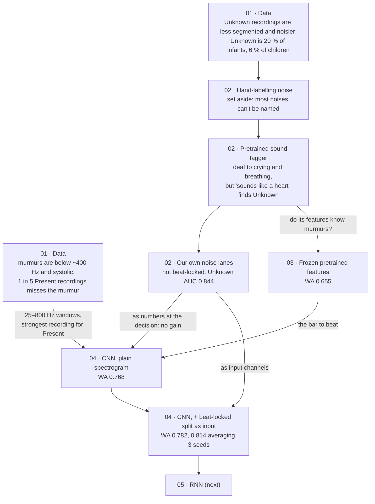

# Heart Murmur Detection

Deep learning classifiers that detect heart murmurs from phonocardiogram (PCG) recordings, using the [CirCor DigiScope](https://physionet.org/content/circor-heart-sound/1.0.3/) dataset.

Project for **Machine Learning II (CC3043)**, DCC/FCUP, 2026/2027.

## Task

Given the heart sound recordings of a patient, predict the patient-level `Murmur` label:

| Label | Meaning |
|---|---|
| `Present` | A murmur was heard |
| `Absent` | No murmur was heard |
| `Unknown` | The expert could not decide (noise, poor recording quality) |

This is the murmur task of the [George B. Moody PhysioNet Challenge 2022](https://physionet.org/content/challenge-2022/1.0.0/).

Points that shape the design:

- **The label belongs to the patient, not to a recording.** Each patient has up to four recordings (aortic, pulmonary, tricuspid and mitral valves), and a murmur may be audible at only some of them. The system outputs exactly one prediction per patient.
- **The classes are imbalanced.** Most patients are `Absent`, and `Unknown` is the smallest class.

## Dataset

The public part of CirCor DigiScope has **3163 recordings from 942 patients** aged 0 to 21. Recordings last between 4.8 and 80.4 seconds.

The dataset is **not included** in this repository. To download it into `data/`:

```bash
scripts/download_data.sh
```

The script fetches the files from PhysioNet's open-data S3 mirror (much faster than the main PhysioNet server) and checks them against the official `SHA256SUMS.txt`.

You can also download the ZIP from the [dataset page](https://physionet.org/content/circor-heart-sound/1.0.3/). Place the contents in `data/` so that the layout is:

```
data/
├── training_data.csv        # one row per patient, includes the Murmur label
└── training_data/
    ├── <id>_<loc>.wav       # audio, loc ∈ {AV, PV, TV, MV, Phc}
    ├── <id>_<loc>.hea       # WFDB header
    ├── <id>_<loc>.tsv       # heart cycle segmentation (S1, systole, S2, diastole)
    └── <id>.txt             # patient metadata
```

## Approach

We implement two of the three architectures required by the assignment (MLP, CNN, RNN). Each model goes through the same four stages:

1. **Pre-processing:** resampling, splitting recordings into fixed-length windows, normalization, and feature extraction (e.g. mel-spectrograms, MFCCs).
2. **Model architecture:** the network design for each classifier.
3. **Training strategy:** loss and class-imbalance handling, optimizer, hyperparameter selection, regularization.
4. **Evaluation:** patient-level predictions scored with the weighted accuracy.

The recording-level predictions are aggregated into one prediction per patient.

### How we got here

Each step was prompted by what the previous one found. The notebooks follow the same story.



1. **Look at the data first (notebook 01).** Unknown means the doctor could not decide, and the data shows
   why: Unknown recordings are about two-thirds unsegmented (under half for the others), noisier, and
   concentrated in infants. Murmurs sit below ~400 Hz, in systole, and about 1 in 5 recordings of a Present
   patient is taken where the murmur is not heard. These set the input (25–800 Hz windows) and the patient
   rule (Present from the patient's strongest recording).
2. **Unknown is about noise, so measure noise (notebook 02).** Unknown weighs 3 but has only 54 training
   patients, too few to learn from alone. We first tried labelling noise by hand; after one session it was
   set aside, because most short noises in stethoscope audio cannot be named confidently. A pretrained sound
   tagger (AudioSet) turned out deaf to crying, breathing and handling at our 4 kHz, but its "sounds like a
   heart" score already separates Unknown.
3. **Separate the actors (notebook 02).** The idea came from music source separation, which splits a song
   into instruments: in a heart recording, only the heart (and its murmur) repeats with every beat. Our
   "not beat-locked" measure splits each recording into what repeats with the beat and what does not.
   Listening to recordings shaped it: a first version that accepted any repetition let steady breathing
   pass as heart (0.73), locking it to the heartbeat fixed that (0.84). It does not react to murmurs.
4. **How far does a big pretrained model get? (notebook 03).** The tagger's labels were of little use, but
   its internal features might carry more. Frozen, with a linear classifier: 0.655, and a randomly initialised copy
   already gets 0.608. So a convolutional network trained on our own data is the way to go.
5. **Train our own CNN (notebook 04).** 0.768. Adding the noise measures as extra numbers at the decision
   did not help. Giving the network the split itself, as two extra input channels, did: 0.782 over 3
   training seeds, winning 4 of 5 folds, and 0.814 when the 3 seeds' predictions are averaged.
6. **Next: the RNN.** Unknown is still the weak class (13 of 54 found).

## Evaluation

### Protocol

- Data is split **by patient**: all recordings of a patient belong to the same subset.
- Splits are **stratified** by the `Murmur` label.
- The test set is never used for model decisions (architecture, hyperparameters, early stopping, thresholds). Those decisions use the validation set only.

### Metric

The main metric is the weighted accuracy from the PhysioNet Challenge 2022, computed at the patient level. `Present` patients weigh 5, `Unknown` 3 and `Absent` 1:

$$
\mathrm{WA}_{\text{murmur}} = \frac{5\,m_{PP} + 3\,m_{UU} + m_{AA}}{5\,(m_{PP}+m_{UP}+m_{AP}) + 3\,(m_{PU}+m_{UU}+m_{AU}) + (m_{PA}+m_{UA}+m_{AA})}
$$

Here $m_{ij}$ is the number of patients predicted as class $i$ whose true class is $j$. Reference implementation: [physionetchallenges/evaluation-2022](https://github.com/physionetchallenges/evaluation-2022).

For each classifier we report the weighted accuracy and the patient-level confusion matrix.

## Results

Out-of-fold weighted accuracy over the 753 training patients (5 folds); the test split is not used yet.

| Model | Weighted accuracy | Notes |
|---|---|---|
| Always Present | 0.499 | reference |
| Frozen PANNs features + logistic regression | 0.655 | notebook 03 |
| CNN, log spectrogram | 0.768 | mean of 3 training seeds; notebook 04 |
| CNN, spectrogram + beat-locked part + leftover | 0.782 | mean of 3 training seeds; notebook 04 |
| the same, 3 seeds averaged | **0.814** | Present 127/143, Unknown 13/54, Absent 493/556 |

## Setup

```bash
git clone https://github.com/AndreXie05/HeartMurmurDetection.git
cd HeartMurmurDetection
conda env create -f environment.yml
conda activate hmd
```

This installs the dependencies (exact versions in `requirements.txt`) and the project's `murmur`
package, so the notebooks can `import murmur`. Without conda, in any Python 3.12 environment:
`pip install -r requirements.txt && pip install -e .`

## Usage

Download the data first: `bash scripts/download_data.sh`. Then open the notebooks in order:

| notebook | what it shows |
|---|---|
| `01-data-exploration` | the dataset, the labels, segmentation, spectra, and Unknown by age |
| `02-noise-and-unknown` | measuring noise without hand labels, and how well it separates the Unknown class |
| `03-pretrained-features` | how far a frozen pretrained audio model (PANNs) gets: WA 0.655 |
| `04-cnn` | our CNN, plain vs with the beat-locked noise split as input: WA 0.768 vs 0.782 (0.814 averaging 3 seeds) |

Each notebook reads stored results from `results/` (tables and the trained CNN weights) and runs in
minutes; set `RECOMPUTE = True` at the top to redo the computation (some steps need a GPU). All scores are
cross-validated on the training patients; the test split is not used yet.

## Team

- André Xie
- _Member 2_
- _Member 3_
